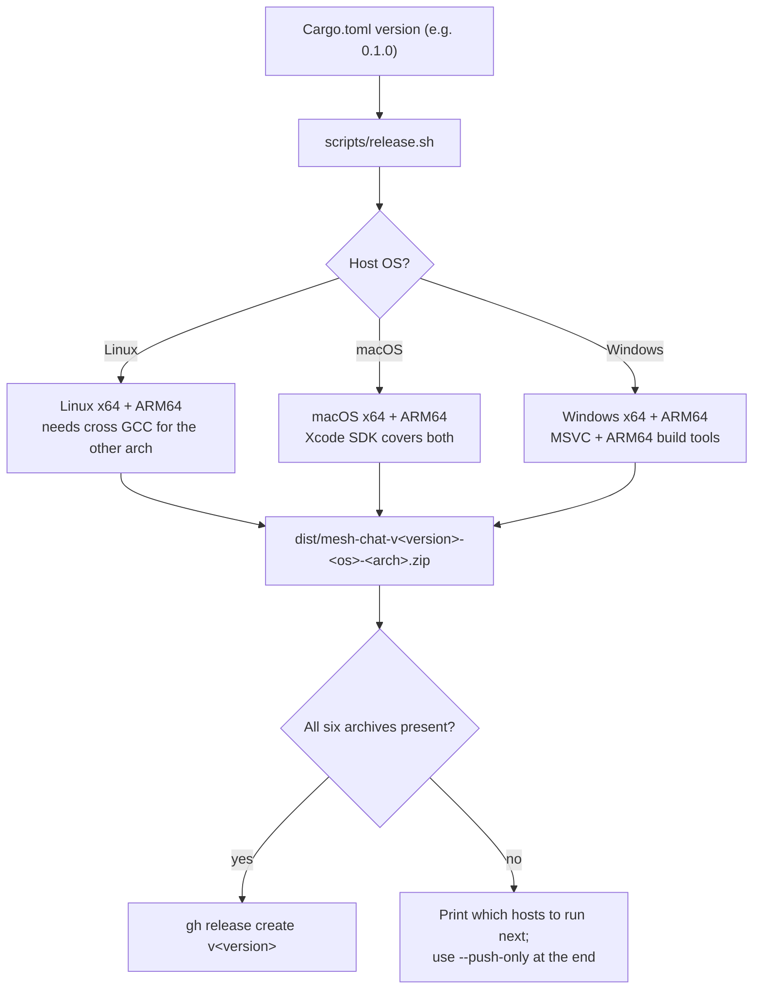
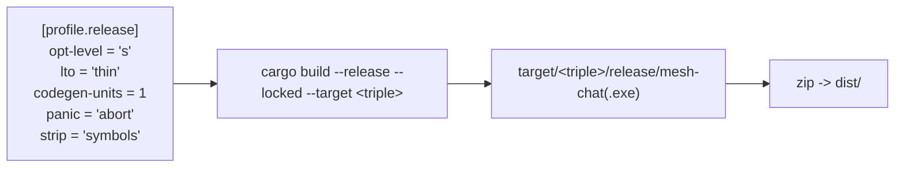

# Build and release

This document describes how `mesh-chat` binaries are produced, what each pipeline can and cannot do, and how to publish a release. For running the app itself, see [README.md](README.md).

## High-level pipeline



The same Cargo profile is used for every target, so optimization and stripping are identical across OSes and architectures:



## Quick reference

| Command | Result |
| --- | --- |
| `make build` | Optimized native binary in `target/release/` (or `.exe` on Windows) |
| `make run ARGS="--simple"` | Run from source with arguments |
| `make test` | Unit tests (dev profile, `cargo test --all-targets --locked`) |
| `make build-linux-x64` … `make build-windows-arm64` | One cross-target build + ZIP |
| `make dist` | Build everything this host supports, write `dist/*.zip` |
| `make release` | Same as `dist`, then publish if all six archives exist |
| `make push-release` | Publish existing `dist/*.zip` without rebuilding |

All build commands use `--locked`, so `Cargo.lock` is respected exactly.

## Target matrix

| Label | Rust target | Build host | Extra requirement | Archive |
| --- | --- | --- | --- | --- |
| `linux-x64` | `x86_64-unknown-linux-gnu` | Linux | `x86_64-linux-gnu-gcc` when on ARM | `mesh-chat-v<version>-linux-x64.zip` |
| `linux-arm64` | `aarch64-unknown-linux-gnu` | Linux | `aarch64-linux-gnu-gcc` when on x64 | `mesh-chat-v<version>-linux-arm64.zip` |
| `macos-x64` | `x86_64-apple-darwin` | macOS | Xcode command-line tools | `mesh-chat-v<version>-macos-x64.zip` |
| `macos-arm64` | `aarch64-apple-darwin` | macOS | Xcode command-line tools | `mesh-chat-v<version>-macos-arm64.zip` |
| `windows-x64` | `x86_64-pc-windows-msvc` | Windows | MSVC build tools | `mesh-chat-v<version>-windows-x64.zip` |
| `windows-arm64` | `aarch64-pc-windows-msvc` | Windows | MSVC **ARM64** build tools | `mesh-chat-v<version>-windows-arm64.zip` |

Each ZIP contains the binary (`mesh-chat` or `mesh-chat.exe`) and a copy of `README.md`.

## Running the pipelines

### 1. Native build (any host)

```sh
make build          # target/release/mesh-chat
make test
```

This is the normal local workflow and does not require `zip`, `gh`, or cross toolchains.

### 2. One cross target

```sh
make build-linux-arm64
# or
./scripts/release.sh --no-push --only macos-x64
```

The script installs the Rust standard library for the target when `rustup` is available, builds with the release profile, and writes that single ZIP to `dist/`.

### 3. Full release pipeline (one run per host OS)

1. Bump `version` in `Cargo.toml`, commit, and push. The release tag is always `v<version>`; it cannot be overridden.
2. On a **Linux** host, install the cross compiler for the *other* architecture if needed, then:
   ```sh
   sudo dnf install gcc-x86_64-linux-gnu   # Fedora example, when on ARM
   # or: sudo apt install gcc-aarch64-linux-gnu   # when on x64
   ./scripts/release.sh --no-push
   ```
3. On a **macOS** host:
   ```sh
   xcode-select --install
   ./scripts/release.sh --no-push
   ```
4. On a **Windows** host (Git Bash / MSYS2), with MSVC and ARM64 build tools installed:
   ```sh
   ./scripts/release.sh --no-push
   ```
5. Once all six archives exist in `dist/`, publish from any host that has `gh` authenticated:
   ```sh
   make push-release
   ```

If a plain `./scripts/release.sh` run finishes with all six archives present, it publishes automatically. If archives are missing, it prints which ones and exits successfully so the pipeline can continue on the other hosts.

### Script flags

| Flag | Meaning |
| --- | --- |
| `--only LABEL` | Build just one target from the matrix. |
| `--no-push` | Build and ZIP only. |
| `--push-only` | Skip builds, verify the six archives, publish. |
| `-h`, `--help` | Show usage. |

## Limitations

- **One binary per architecture.** x64 and ARM64 are separate archives. There is no macOS universal binary and no Linux/Windows multi-arch wrapper.
- **macOS must be built on macOS.** The Apple SDK is tied to Xcode; the script does not attempt osxcross or SDK extraction on Linux.
- **Windows must be built on Windows.** MSVC linkers and the Windows SDK are Windows-only. Windows ARM64 needs the ARM64 MSVC components; the GNU/Mingw ARM64 target is not usable for this project.
- **Linux cross builds need a cross GCC.** `rustup target add` only installs `std`; a C compiler for the target is still required by `ring` and bundled SQLite.
- **glibc linking.** Linux binaries link glibc dynamically. They need a glibc at least as new as the build host's. If you support older distributions, build on the oldest one you intend to support.
- **Tooling required.** `zip` is needed on every host that creates archives; `gh` (with `gh auth login`) and a Git tag are needed to publish. The script refuses to overwrite an existing tag or release — bump `Cargo.toml` first.
- **No signing or notarization.** These are personal-use binaries. macOS Gatekeeper or Windows SmartScreen may warn; the builds are not submitted to any store.
- **Dependency auditing is manual.** `cargo audit` is not installed here and is not part of the script. Run it yourself if you want advisory checks.
- **Release profile changes behavior.** `panic = "abort"` and `strip = "symbols"` mean no unwinding and no debug symbols in release binaries. Tests run in the dev profile and are unaffected.
- **`dist/` is ignored by Git.** Only the six expected archive names are published, so stale archives from older versions are not uploaded by mistake.
- **Cross builds are not verifiable in this sandbox.** It has no `rustup`, `zip`, `gh`, or `git` CLI and only the native `aarch64-unknown-linux-gnu` target installed. Review the script's host checks and run it on each real host.

## Security-related build choices

- `[profile.release]` uses `opt-level = "s"`, thin LTO, one codegen unit, `panic = "abort"`, and full symbol stripping on every OS and architecture.
- `identity.key` is created with `0600` permissions atomically on Unix (no write-then-chmod window).
- `chat.log` is created with `0600` permissions on Unix so peer names and IDs are not world-readable.
- `rust-toolchain.toml` pins Rust 1.97.1, and all build commands pass `--locked`.
