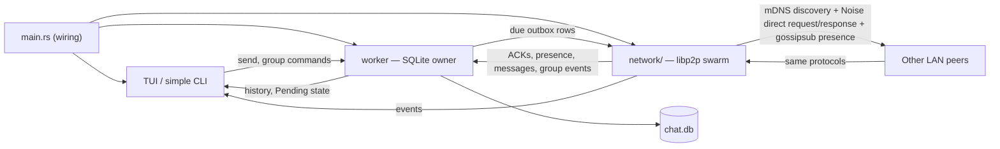

# mesh-chat

A serverless, peer-to-peer chat for the terminal. Peers find each other on the local network with **mDNS**, exchange usernames and messages over direct **Noise-encrypted libp2p** connections, and use gossipsub only for presence. There is no central server and no account to create.

History, group memberships and undelivered messages are kept in a local SQLite database, so messages to offline peers stay pending, survive restarts, and are retried with exponential backoff when those peers come back online. You can also send files over the same encrypted direct channels.

> **Current scope:** peers must be on the same local network. mDNS uses multicast UDP 5353 and requires a shared L2 broadcast domain; VPNs, Docker bridge networks and Wi-Fi client isolation usually block it. Connecting to peers outside the local network is not implemented yet.
>
> **File sharing scope:** files can be attached to direct messages only (not `#general` or private groups). Each attachment is sent inline inside the encrypted direct message, with a 15 MB per-message limit.

## Running it

Requirements:

- Rust 1.97.1 (pinned in `rust-toolchain.toml`; MSRV 1.88).
- All peers on the same local network, with UDP 5353 multicast available.

Platform notes for released binaries:

- **Linux (x64 / ARM64):** dynamically linked against glibc; needs a glibc at least as new as the build host's.
- **macOS (x64 / ARM64):** separate thin binaries, no universal build. Binaries are unsigned, so Gatekeeper may warn on first launch.
- **Windows (x64 / ARM64):** unsigned executables may trigger a SmartScreen warning.

```sh
make build   # cargo build
make test    # cargo test --all-targets
make run     # cargo run (full-screen TUI)
```

You will be asked for a username, then the full-screen UI opens. A real terminal is recommended because the UI uses the alternate screen and raw mode.

`make build` produces an optimized native binary in `target/release/`. Cross-target builds, the release pipeline, tooling requirements and limitations are documented in [Build.md](Build.md).

For a plain line-by-line terminal instead:

```sh
make run ARGS="--simple"
```

### Two instances on one laptop

Both processes need **different data directories**. Otherwise they load the same `data/identity.key`, share a PeerId, and ignore each other as "self".

```sh
# Terminal 1
make run ARGS="--data-dir data/alice"

# Terminal 2
make run ARGS="--data-dir data/bob"
```

Each directory gets its own `identity.key`, `chat.db` and `chat.log`. Peers should discover each other within a few seconds; type `/users` to see them. On two different laptops the default `make run` is enough.

### Using the TUI

- `Enter` sends the current input; `Shift+Enter` inserts a newline.
- `Tab` completes what you are typing: slash commands, `/group` subcommands, usernames after `/users` or `/group add`, group names, and file paths after `/file` or `/attach`. A hint appears under the input; `Esc` dismisses it. Unambiguous prefixes such as `/u` or `/g cr` also work when you press `Enter`, without completing first.
- `↑`/`↓` select a channel or group; `Enter` or `Tab` switches to it; `Esc` returns focus to the input. Typing any character also returns focus to the input.
- `/quit`, `/exit` or `Ctrl+C` exits and restores the terminal.
- Incoming messages in a conversation you are not viewing add a yellow `●` to its label in `CHANNELS`/`GROUPS` and in the header tabs. Opening the conversation clears it, even after a restart: unread conversations (with first/last unread timestamps) are stored in SQLite and the row is deleted once read.
- Mouse support is enabled in the TUI: click an attachment line (`📎 filename → path`) to open it with the OS default application.

The complete `/u` → Tab → username → Tab → send flow is covered end to end in `src/ui/autocomplete_tests.rs`; the unread-marker flow is covered in `src/ui/unread_tests.rs`.

| Command | Effect |
| --- | --- |
| `/users` | Print known peers in the chat panel |
| `/users <name>` | Open the direct-message tab for that user |
| `/users <name> <body…>` | Send a direct message; body may be multiline |
| `/file <path>` | Attach a file to the next direct message (use `Tab` to complete the path) |
| `/attach <path>` | Alias for `/file <path>` |
| `/group create <name>` | Create a private group; only you see it at first |
| `/group add <group> <name>` | Invite a user; any member can invite more users |
| `/group members <group>` | List current members of a group |
| `/help` | Show short command help |

Plain text goes to the active conversation: `#general` (everyone online), a direct-message thread, or a private group. Every chat line has a local `HH:MM` timestamp. A send to an offline recipient shows `(Pending)` until it is acknowledged; retries run at 1 s, 2 s, 4 s … capped at 5 minutes, and nothing is dropped.

### Sending files

Files can only be attached to direct messages:

1. Switch to a DM channel (or use `/users <name> <body…>`).
2. Type `/file <path>` (or `/attach <path>`). Press `Tab` to complete the path.
3. A hint shows the attached file. Type an optional caption and press `Enter`.

The sender sees the original absolute path, so clicking it opens the source file. The receiver's copy is saved under `data/downloads/<YYYYMMDD>_<username>_<filename>` and opened by the OS when clicked.

Total attachments per message are capped at 15 MB. Filenames are sanitized and collisions are deduplicated with a numeric suffix.

Usernames are labels, so each peer is shown as `name·<last4 of PeerId>`. Connected peers and their messages are green, offline or unknown senders are gray, and your own messages are green.

### Files created at runtime

With the default `--data-dir data`:

- `data/identity.key` — ed25519 private key (mode `0600` on Unix). The PeerId stays the same across restarts; delete the file to get a new identity.
- `data/chat.db` — SQLite database (WAL mode) holding peers, messages, group memberships, outbox rows and file attachment metadata.
- `data/downloads/` — files received from other users, named `<YYYYMMDD>_<username>_<filename>`.
- `data/chat.log` — tracing output. Logs go to a file so the terminal stays clean. Set `RUST_LOG=debug` for verbose diagnostics.

## Architecture



`main.rs` wires three independent owners: the UI draws state, the worker is the only owner of the SQLite connection, and `network/` owns the swarm. The network task handles mDNS discovery, direct encrypted request/response for messages, invites and acknowledgements, and gossipsub only for presence.

### How a message flows

**Sending a message or file**

1. The user presses `Enter` in the UI.
2. The UI asks the **worker** to save the outgoing message. For files, the worker reads the source file and stores attachment metadata.
3. The worker writes one `messages` row and one `outbox` row per recipient in a single SQLite transaction.
4. The worker polls the outbox every ~500 ms. Due rows for online peers are claimed and handed to the **network** layer as encrypted direct requests.
5. The network layer sends each request over a Noise-encrypted libp2p connection and waits for an ACK.
6. The network reports the result back to the worker, which marks the outbox row `done` or schedules a retry with exponential backoff.
7. The UI shows `(Pending)` while any recipient has an undelivered outbox row.

**Receiving a message or file**

1. The **network** layer receives an encrypted direct request from a peer.
2. The network emits a `MessageReceived` event. It is mirrored to both the **worker** and the **UI**.
3. The UI renders the message immediately so the user sees it without waiting for disk I/O.
4. The worker stores the message in `chat.db`. For files, it also writes the bytes to `data/downloads/` and then tells the UI the final local path.
5. If the conversation was not open, the worker writes an unread marker; the UI shows a yellow `●` on the channel/group label.

### Offline resilience

The outbox stores one row per (message, recipient), so group fan-out is acknowledged individually. Rows are only dequeued for peers currently online; delivery reports mark them done or apply backoff. When a peer comes back online, a presence event wakes the worker and pending rows for that peer are flushed automatically. This is what lets offline messages and file attachments survive restarts.

### Folder structure

- `src/main.rs` — CLI arguments, identity loading, logging and wiring between the UI, network and database worker.
- `src/files.rs` — downloads folder management, filename sanitization/deduplication and OS file opening.
- `src/network/`
  - `mod.rs` — swarm task, network commands/events, peer map and direct sends with ACK correlation.
  - `behaviour.rs` — mDNS, identify, request-response and gossipsub composition.
  - `events.rs` — swarm and behaviour events mapped to app-level network events.
  - `protocol.rs` — wire types for chat, presence, group invites and ACKs.
- `src/database/`
  - `mod.rs` — SQLite schema setup and the only connection to `chat.db`, owned by the worker.
  - `migration/0001_schema.sql` — table and index definitions.
- `src/worker.rs` — `Store` request/reply API, outbox poll loop, retry backoff and event mirroring.
- `src/ui/`
  - `mod.rs` — UI event loop, action dispatch and routing of network/worker events into app state.
  - `cli.rs` — plain line-by-line prompt (`--simple`), kept as a fallback.
  - `app.rs` — state: peers, groups, conversations, pending ack map, stable colors, history restoration and RAII terminal guard.
  - `input.rs` — key handling, command parser and channel navigation.
  - `render.rs` — ratatui layout and tests using `TestBackend`.
- `Cargo.toml` — crate metadata and dependencies; `Makefile` — `build`, `run`, `test` and convenience targets.

## What is implemented

- mDNS peer discovery with stable PeerIds persisted in an identity file.
- Noise-encrypted direct messages, one-to-one and `#general` broadcasts, with delivery acknowledgements.
- Full-screen terminal UI with multiline input, command/username autocompletion, channels, direct messages, stable per-peer colors and `(Pending)` state; a plain `--simple` CLI is also available.
- Private invite-only groups with chain invites: any member can invite more members, and member lists converge across all existing members. Non-members never see group names or messages.
- Local SQLite persistence: history, peers, group memberships and an outbox with exponential-backoff retries and offline flushing on reconnect.
- File sharing in direct messages: attach files with `/file` or `/attach`, store received files in `data/downloads/`, render them as clickable attachment lines, and open them with the OS default application.
- Unit tests across all modules (`make test`).

## What is missing

- **Connections beyond the local network.** No WebRTC-style NAT traversal, manual `/connect <multiaddr>`, DHT discovery or relay support yet.
- **Group encryption keys.** Messages are Noise-encrypted between peers, but there is no separate group key; metadata such as membership and traffic patterns is visible to a peer sniffing the LAN. Groups are not a secure channel against local sniffing.
- **Group management.** No leave/remove commands, and new members get no history backfill.
- **Message search and pagination.** The TUI shows a bounded recent window (1000 lines per conversation); older history lives in SQLite but cannot be browsed yet.
- **Automated multi-process integration tests.** Multi-peer behavior is currently verified manually with the two-instance setup above.
